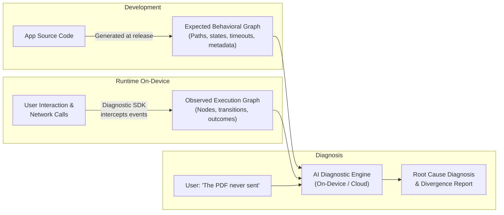
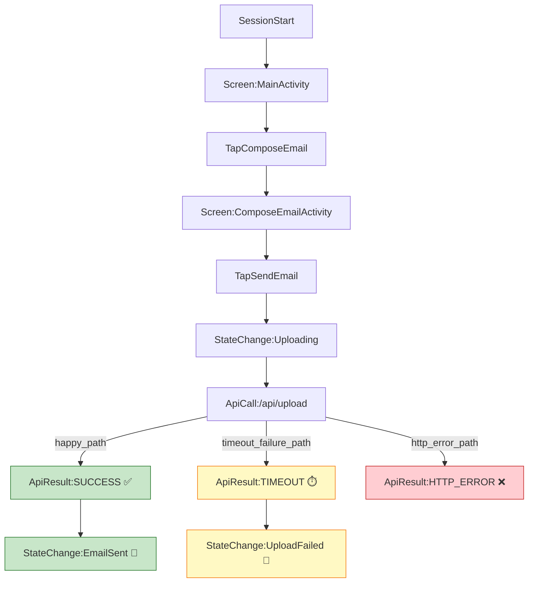

# Argus: SystemSleuth

> **AI-Powered Behavioral Self-Diagnosis for Modern Software**  
> Turning passive applications and websites into intelligent systems that understand their expected behavior, observe runtime execution graphs, and diagnose their own failures using AI.

[](LICENSE)
[](#roadmap)
[](examples/android-email-demo)
[](packages/web-sdk)

---

## 📖 The Problem

When users encounter technical issues in an app or website — a screen that gets stuck, a feature that silently fails, or an upload that spins forever — resolving it is slow and frustrating:

1. **Vague bug reports:** Users cannot describe internal app states or technical exceptions ("*It just didn't work*").
2. **Missing context:** Developers lack a complete, chronological picture of what happened on the user's specific device and application version.
3. **Hard-to-reproduce bugs:** Environmental factors, state machine divergences, and intermittent network timeouts are notoriously difficult to reproduce.

**What if applications understood how they were supposed to behave, tracked what actually happened, and diagnosed their own failures?**

---

## 💡 The Solution: Graph-Based Behavioral Self-Diagnosis

Argus replaces fragile, unsearchable text logs with **structured behavioral graphs**:



### The 6-Step Workflow

1. **Expected Behavioral Graph:** Workflows, transitions, dependencies, and constraints are defined as a graph alongside application releases.
2. **Version Synchronization:** The graph updates with each app version or remote configuration flag.
3. **Execution Graph Recording:** A lightweight on-device SDK intercepts navigation, UI actions, and API calls to reconstruct the actual execution path.
4. **Natural Language Issue Reporting:** The user simply explains what went wrong in plain language.
5. **Graph Divergence Analysis:** An AI agent compares the expected behavioral model against the observed execution graph to pinpoint the exact node and transition where failure occurred.
6. **Automated Recovery or Escalation:** The agent guides the user, triggers safe self-healing recovery, or exports an actionable report for engineering teams.

---

## 📸 Demo & Visualization

### On-Device Recording & In-App Diagnostics
In our sample workflow, the user attempts to send an email with a 4.2 MB PDF attachment. The simulated backend delays response headers, causing an OkHttp `SocketTimeoutException` at 10 seconds. Argus automatically catches the failure, flushes the execution graph to the device's **Downloads** folder (`Downloads/execution_graph.json`), and provides in-app inspection and sharing:

| Execution Graph Inspection | Video Walkthrough |
| :---: | :---: |
|  | [▶️ Watch Demo Video](assets/demo-video.mp4) |

*You can inspect the screen recording of the workflow in [`assets/demo-video.mp4`](assets/demo-video.mp4).*

---

### Interactive 2D & 3D Graph Visualizers

Argus includes standalone browser visualizers to explore expected and recorded behavioral graphs:

- **3D Graph Visualizer:** [`visualizer/graph-3d.html`](visualizer/graph-3d.html) — Interactive 3D orbital visualization fanning out the Happy Path, Timeout Failure Path, and HTTP Error Path in spatial coordinates.
- **2D Graph Explorer:** [`visualizer/graph-2d.html`](visualizer/graph-2d.html) — Pan-and-zoom node graph with path filtering and metadata inspection.

*To view them, simply open the HTML files in any browser.*



---

## 🗂 Repository Structure

```
Argus/
├── packages/                   # Core Platform Diagnostic SDKs
│   └── web-sdk/                # @argus/web JavaScript / TypeScript Diagnostic SDK
│       ├── argus-web.js        # Standalone browser bundle (zero build step needed)
│       └── src/                # Interceptors (Fetch, Nav, Click, Error) & DiagnosticWidget
├── assets/                     # Demo screenshots and screen recordings
│   ├── demo-video.mp4
│   └── screenshot.png
├── spec/                       # Graph schemas & reference specifications
│   ├── expected_graph.json     # Expected behavioral graph definition
│   └── sample_execution_graph.json # Actual recorded on-device failure trace
├── visualizer/                 # Interactive browser-based graph visualizers
│   ├── graph-2d.html           # 2D canvas interactive graph
│   └── graph-3d.html           # 3D orbital perspective visualizer
├── tools/                      # Standalone Developer & Extraction Tools
│   ├── apk-analyzer/           # Black-Box Behavioral Reconstruction (Android APK & On-Device)
│   ├── diagnostic-engine/      # AI Divergence Analysis & Root-Cause Diagnostic CLI/Server
│   └── web-crawler/            # Black-Box Behavioral Reconstruction (Live Web URL Crawler)
├── skills/                     # AI Skills & Extractor Tooling
│   ├── android-graph-extractor/ # Test-driven extractor for Android test suites
│   └── web-graph-extractor/     # Test-driven extractor for Web (Playwright/Cypress)
├── examples/                   # Independent platform demonstration applications
│   ├── android-email-demo/     # Complete Android demo app with Diagnostic SDK
│   └── web-checkout-demo/      # Interactive E-Commerce Checkout demo with in-browser widget
├── LICENSE                     # Apache 2.0 Open Source License
└── README.md
```

---

## 🧩 Graph Specification Schema

### Node Types
- `SESSION_START`: Application initialization and session metadata.
- `SCREEN_VIEW` / `PAGE_VIEW`: Navigation to an Activity, Fragment, or web route.
- `USER_ACTION`: Intentional user input (button clicks, form inputs).
- `API_CALL`: Outbound network request.
- `API_RESULT`: Network response, HTTP code, latency, or timeout.
- `STATE_CHANGE`: Internal state transition (e.g., loading, success, failure).
- `ERROR`: Uncaught exceptions or handled runtime faults.

### Divergence Detection Example
When the user states:
> *"I clicked Pay Now, but it kept loading and never placed my order."*

The diagnostic engine compares the paths:
- **Expected Happy Path:** `StateChange:ProcessingPayment` ➔ `ApiCall:/api/v1/charge` ➔ `ApiResult:200` ➔ `StateChange:OrderConfirmed`
- **Observed Trace:** `StateChange:ProcessingPayment` ➔ `ApiCall:/api/v1/charge` ➔ `ApiResult:TIMEOUT` (elapsed: `8014ms`) ➔ `StateChange:PaymentFailed`
- **Diagnosis:** The payment gateway endpoint timed out after 8,000ms. Known causes include payment gateway latency or client timeout threshold set too low for 3D Secure verification.

---

## 🚀 Example Applications

Argus is designed with clean platform decoupling — Android and Web modules run completely independently:

### 1. Web Checkout Demo (`examples/web-checkout-demo/`)
* **Zero-Setup Testing:** Open [`examples/web-checkout-demo/index.html`](examples/web-checkout-demo/index.html) in any browser.
* **Interactive Scenarios:** Test payment gateway timeouts, CORS rejections, or normal success.
* **In-Browser Diagnostic Pill:** Displays live node counts and turns red on failures (`⚠️ 1 failure`). Click to inspect the full trace or download `execution_graph.json` with zero command-line tools.

### 2. Android Email Demo (`examples/android-email-demo/`)
* Open `examples/android-email-demo` in Android Studio and run on device or emulator.
* Simulates PDF attachment upload timeout at 10 seconds.
* Automatically saves `execution_graph.json` into the device's public **Downloads** directory using `MediaStore` — zero ADB needed.

---

## 🧠 Generating Expected Graphs: White-Box vs. Black-Box Behavioral Reconstruction

Argus supports both operational paradigms depending on what assets you have access to:

| Paradigm | When to Use | Tool / Skill | How It Works |
|---|---|---|---|
| **White-Box Code Analysis** | You have application source code & test suites | [`skills/`](skills/) (`android-graph-extractor`, `web-graph-extractor`) | Scans executable test specs (Playwright, Cypress, Espresso, JUnit), routing tables, and API interfaces to extract expected behavior. |
| **Black-Box (Web)** | You only have a live website URL or raw DOM | [`tools/web-crawler/`](tools/web-crawler/) | Reconstructs behavioral workflows by discovering DOM interactive controls, form fields, and network call patterns without requiring source code. |
| **Black-Box (Mobile)** | You only have a compiled APK or installed on-device app | [`tools/apk-analyzer/`](tools/apk-analyzer/) | Deconstructs manifest activities, launcher entrypoints, deep links, and multi-DEX string pools to synthesize mobile state machines. |

### Quick CLI Usage:

```bash
# 1. Run Automated AI Diagnosis (Expected Contract + Runtime Trace + User Complaint)
python tools/diagnostic-engine/diagnose.py \
  -e spec/expected_graph.json \
  -a spec/sample_execution_graph.json \
  -q "I clicked send email with a PDF, but it never confirmed" \
  -o diagnosis_report.md

# 2. Black-Box: Reconstruct expected graph from a live Web URL
python tools/web-crawler/crawler.py https://example.com/checkout -o expected_graph.json

# 3. Black-Box: Reconstruct expected graph from an Android APK or on-device package
python tools/apk-analyzer/analyzer.py path/to/app-debug.apk -o expected_graph.json
# Or directly from a connected Android phone/emulator:
python tools/apk-analyzer/analyzer.py com.example.app --device -o expected_graph.json

# 4. White-Box: Extract from existing codebase tests and specs
python skills/web-graph-extractor/scripts/extract_web_context.py /path/to/web-repo -o web_context.md
python skills/android-graph-extractor/scripts/extract_code_context.py /path/to/android-repo -o android_context.md
```

---

## 🗺 Open-Source Roadmap

- [x] **Phase 1:** Core graph data model & schema specification.
- [x] **Phase 1:** Android Diagnostic SDK (Activity tracking, user action wrappers, OkHttp interceptor).
- [x] **Phase 1:** On-device zero-ADB export (MediaStore Downloads & native share sheet).
- [x] **Phase 1:** 2D and 3D interactive graph visualizers.
- [x] **Phase 2:** Web Diagnostic SDK (`@argus/web`) & in-browser floating diagnostic widget.
- [x] **Phase 2:** Web E-Commerce Checkout interactive demo with network scenario simulator.
- [x] **Phase 2:** Test-driven automated behavioral graph extraction for Android & Web (`skills/`).
- [x] **Phase 2:** Black-Box Behavioral Reconstruction for Web (`tools/web-crawler/`).
- [x] **Phase 2.5:** Black-Box Behavioral Reconstruction for Mobile Apps (`tools/apk-analyzer/`).
- [x] **Phase 3:** Open-source AI Diagnostic Agent CLI and Web service (feed `expected.json` + `actual.json` + user prompt ➔ structured diagnostic report).
- [ ] **Phase 4:** On-device small language model (SLM) diagnostic agent (offline, privacy-preserving diagnosis).
- [ ] **Phase 5:** Self-healing and automated recovery actions (cache busting, safe state reset, token refresh).

---

## 🤝 Contributing

Argus is designed to become a universal, cross-platform diagnostic layer for modern software. We welcome contributions for:
- Platform SDKs (iOS / Swift, React Native, Flutter, Web / React)
- Graph extraction tooling and linters
- Diagnostic LLM prompts and fine-tuned benchmark datasets

Please feel free to open issues or submit pull requests!

---

## 📄 License

This project is licensed under the [Apache License 2.0](LICENSE).
