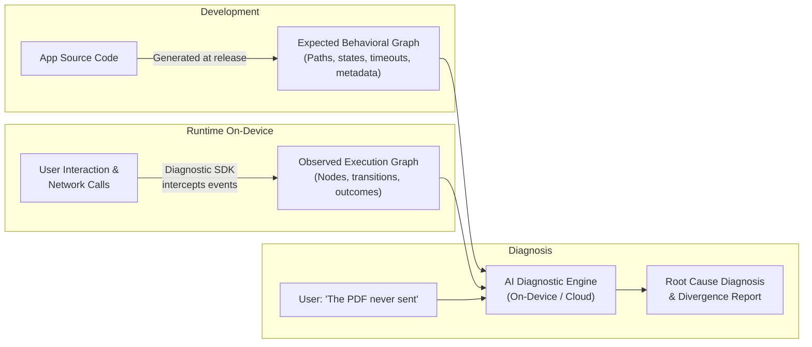
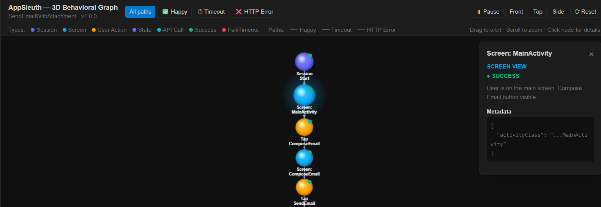
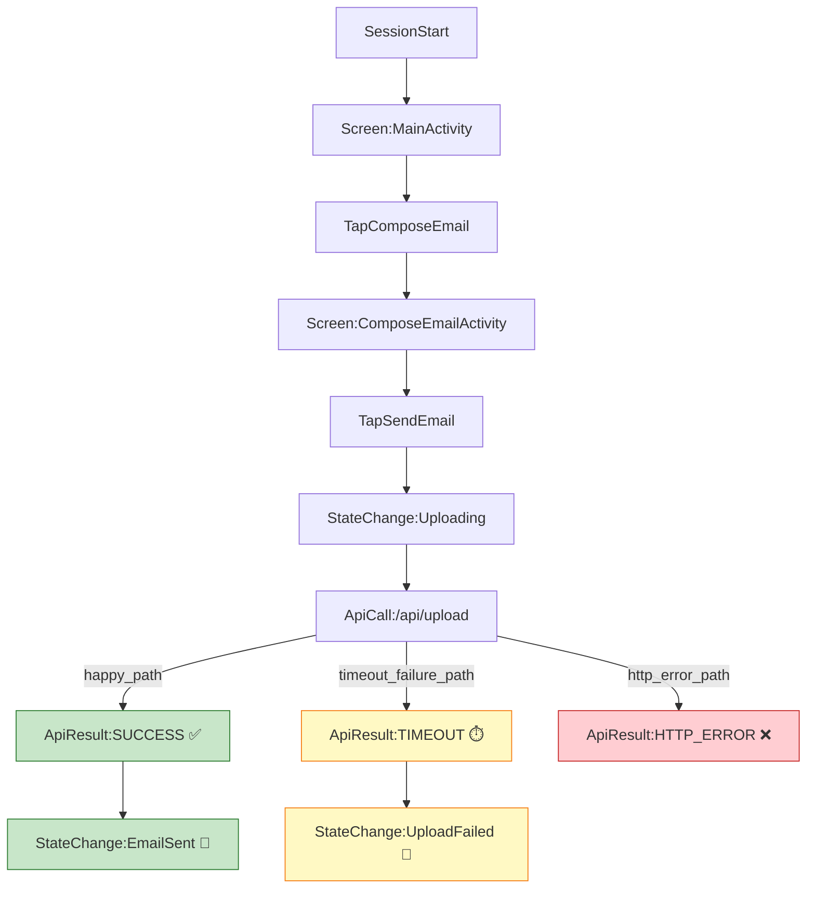

# AppSleuth: AI-Powered Self-Diagnosing Applications

> **Turning passive applications into intelligent systems that understand their expected behavior, observe runtime execution graphs, and diagnose their own failures using AI.**

[](LICENSE)
[](#roadmap)
[](#architecture)

---

## 📖 The Problem

When users encounter technical issues in an app or website — a screen that gets stuck, a feature that silently fails, or an upload that spins forever — resolving it is slow and frustrating:

1. **Vague bug reports:** Users cannot describe internal app states or technical exceptions ("*It just didn't work*").
2. **Missing context:** Developers lack a complete, chronological picture of what happened on the user's specific device and application version.
3. **Hard-to-reproduce bugs:** Environmental factors, state machine divergences, and intermittent network timeouts are notoriously difficult to reproduce.

**What if applications understood how they were supposed to behave, tracked what actually happened, and diagnosed their own failures?**

---

## 💡 The Solution: Graph-Based Behavioral Self-Diagnosis

AppSleuth replaces fragile, unsearchable text logs with **structured behavioral graphs**:



### The 6-Step Workflow

1. **Expected Behavioral Graph:** Workflows, transitions, dependencies, and constraints are defined as a graph alongside application releases.
2. **Version Synchronization:** The graph updates with each app version or remote configuration flag.
3. **Execution Graph Recording:** A lightweight on-device SDK intercepts navigation, UI actions, and API calls to reconstruct the actual execution path.
4. **Natural Language Issue Reporting:** The user simply explains what went wrong in plain language.
5. **Graph Divergence Analysis:** An AI agent compares the expected behavioral model against the observed execution graph to pinpoint the exact node and transition where failure occurred.
6. **Automated Recovery or Escalation:** The agent guides the user, triggers safe self-healing recovery, or exports an actionable report for engineering teams.

---

## 📸 Demo & Visualization

### On-Device Recording & In-App Diagnostics
In our sample workflow, the user attempts to send an email with a 4.2 MB PDF attachment. The simulated backend delays response headers, causing an OkHttp `SocketTimeoutException` at 10 seconds. AppSleuth automatically catches the failure, flushes the execution graph to the device's **Downloads** folder (`Downloads/execution_graph.json`), and provides in-app inspection and sharing:

| Execution Graph Inspection | Video Walkthrough |
| :---: | :---: |
|  | [▶️ Watch Demo Video](assets/demo-video.mp4) |

*You can inspect the screen recording of the workflow in [`assets/demo-video.mp4`](assets/demo-video.mp4).*

---

### Interactive 2D & 3D Graph Visualizers

AppSleuth includes standalone browser visualizers to explore expected and recorded behavioral graphs:

- **3D Graph Visualizer:** [`visualizer/graph-3d.html`](visualizer/graph-3d.html) — Interactive 3D orbital visualization fanning out the Happy Path, Timeout Failure Path, and HTTP Error Path in spatial coordinates.
- **2D Graph Explorer:** [`visualizer/graph-2d.html`](visualizer/graph-2d.html) — Pan-and-zoom node graph with path filtering and metadata inspection.

*To view them, simply open the HTML files in any browser.*



---

## 🗂 Repository Structure

```
AppSleuth/
├── assets/                     # Demo screenshots and screen recordings
│   ├── demo-video.mp4
│   └── screenshot.png
├── spec/                       # Graph schemas & reference specifications
│   ├── expected_graph.json     # Expected behavioral graph definition
│   └── sample_execution_graph.json # Actual recorded on-device failure trace
├── visualizer/                 # Interactive browser-based graph visualizers
│   ├── graph-2d.html           # 2D canvas interactive graph
│   └── graph-3d.html           # 3D orbital perspective visualizer
├── examples/                   # Platform implementations & sample applications
│   └── android-email-demo/     # Complete Android demo app with Diagnostic SDK
│       ├── app/
│       │   └── src/main/java/com/appsleuth/
│       │       ├── demo/       # Sample email application (UI & logic)
│       │       └── diagnostic/ # AppSleuth Android Diagnostic SDK
│       ├── build.gradle.kts
│       └── README.md
├── LICENSE                     # Apache 2.0 Open Source License
└── README.md
```

---

## 🧩 Graph Specification Schema

### Node Types
- `SESSION_START`: Application initialization and session metadata.
- `SCREEN_VIEW`: Navigation to an Activity, Fragment, or screen.
- `USER_ACTION`: Intentional user input (button clicks, form inputs).
- `API_CALL`: Outbound network request.
- `API_RESULT`: Network response, HTTP code, latency, or timeout.
- `STATE_CHANGE`: Internal state transition (e.g., loading, success, failure).
- `ERROR`: Uncaught exceptions or handled runtime faults.

### Divergence Detection Example
When the user states:
> *"I am trying to send an email with a PDF attachment, but it keeps loading and never sends."*

The diagnostic engine compares the paths:
- **Expected Happy Path:** `StateChange:Uploading` ➔ `ApiCall:/api/upload` ➔ `ApiResult:SUCCESS` ➔ `StateChange:EmailSent`
- **Observed Trace:** `StateChange:Uploading` ➔ `ApiCall:/api/upload` ➔ `ApiResult:TIMEOUT` (elapsed: `10011ms`) ➔ `StateChange:UploadFailed`
- **Diagnosis:** The attachment upload timed out after 10,000ms. Known causes include slow network or undersized client timeout for 4.2 MB attachments.

---

## 🚀 Running the Example Android App

The demo app in [`examples/android-email-demo/`](examples/android-email-demo/) showcases the complete on-device diagnostic flow:

1. Open Android Studio and choose **Open** on `examples/android-email-demo`.
2. Sync Gradle and run the app on any device or emulator (Android 7.0+ / API 24+).
3. Tap **Compose Email** ➔ **Send Email**.
4. The client simulates the 10-second timeout.
5. The execution graph is saved directly to the device's public **Downloads** directory (`Downloads/execution_graph.json`) using Android `MediaStore` — **zero ADB commands required**.
6. Use the in-app **View Graph** or **Share Graph** button to inspect or export the JSON trace.

---

## 🗺 Open-Source Roadmap

- [x] **Phase 1:** Core graph data model & schema specification.
- [x] **Phase 1:** Android Diagnostic SDK (Activity tracking, user action wrappers, OkHttp interceptor).
- [x] **Phase 1:** On-device zero-ADB export (MediaStore Downloads & native share sheet).
- [x] **Phase 1:** 2D and 3D interactive graph visualizers.
- [ ] **Phase 2:** Automated behavioral graph extraction from Android/iOS/Web routing tables and OpenAPI specs.
- [ ] **Phase 3:** Open-source AI Diagnostic Agent CLI and Web service (feed `expected.json` + `actual.json` + user prompt ➔ structured diagnostic report).
- [ ] **Phase 4:** On-device small language model (SLM) diagnostic agent (offline, privacy-preserving diagnosis).
- [ ] **Phase 5:** Self-healing and automated recovery actions (cache busting, safe state reset, token refresh).

---

## 🤝 Contributing

AppSleuth is designed to become a universal, cross-platform diagnostic layer for modern software. We welcome contributions for:
- Platform SDKs (iOS / Swift, React Native, Flutter, Web / React)
- Graph extraction tooling and linters
- Diagnostic LLM prompts and fine-tuned benchmark datasets

Please feel free to open issues or submit pull requests!

---

## 📄 License

This project is licensed under the [Apache License 2.0](LICENSE).
