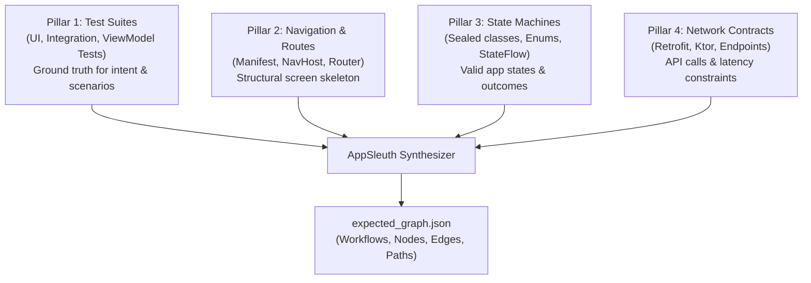

# AppSleuth Graph Extractor Skill

This skill guides an AI agent or LLM through reverse-engineering an **Expected Behavioral Graph** from an application codebase. It uses **test files as the primary behavioral specification**, augmented by navigation routes, state definitions, and API interfaces.

---

## The 4-Pillar Analysis Methodology

To reconstruct an accurate behavioral graph without hallucinating states, extract evidence across 4 pillars:



---

## Extraction Procedure

### Step 1: Scan for Test Files (The Scenario Anchor)
Search for test files matching:
* Android: `*Test.kt`, `*Test.java`, `*ScreenshotTest.kt`
* iOS: `*Tests.swift`, `*Spec.swift`
* Web / React: `*.test.tsx`, `*.spec.ts`, `cypress/`, `playwright/`

**Look for:**
* Test method names describing intent: e.g. `testSendEmail_attachmentTimeout_showsErrorState()`
* Given / When / Then blocks or assertion patterns
* Mocked network conditions: e.g. `SocketTimeoutException`, `HTTP 500`, `HTTP 413`

### Step 2: Map the Structural Skeleton
Identify entry points and navigable screens:
* Android: Look at `AndroidManifest.xml` (`<activity>`, `<intent-filter>`), Jetpack Navigation (`nav_graph.xml`), or Compose `NavHost`.
* Map each screen to a `SCREEN_VIEW` node.

### Step 3: Identify User Actions & State Transitions
Inspect UI click handlers and state representations:
* Click listeners: `setOnClickListener`, `Button(onClick = ...)`, `Modifier.clickable`
* States: Look for `sealed interface UiState`, `enum class Status`, or `StateFlow`
* Map user inputs to `USER_ACTION` nodes.
* Map transitions (e.g. `Loading`, `Success`, `Error`) to `STATE_CHANGE` nodes.

### Step 4: Map Network Endpoints & Constraints
Locate HTTP calls:
* Retrofit interfaces (`@POST`, `@GET`), OkHttp client builders, timeout configurations.
* Map each request to an `API_CALL` node.
* Map responses to `API_RESULT` nodes with expected status codes or timeouts.

### Step 5: Synthesize into Standard AppSleuth Graph Schema
For each workflow identified:
1. Define `entryNode` and `terminalNodes`.
2. Construct the sequence of `nodes` and `edges`.
3. Construct named `paths`:
   * **`happy_path`**: The complete successful sequence from entry to completion.
   * **Failure paths**: Named error paths (e.g., `timeout_failure_path`, `validation_failure_path`), each marked with:
     * `divergesFromHappyPathAt`: The node ID where behavior branches away from normal execution.
     * `isKnownFailureMode: true`
     * `knownCauses`: List of likely root causes based on code or test mocks.

---

## Node Schema Reference

Every node must adhere to this shape:

```json
{
  "id": "n_unique_identifier",
  "type": "SESSION_START | SCREEN_VIEW | USER_ACTION | STATE_CHANGE | API_CALL | API_RESULT | ERROR",
  "label": "Human readable label (e.g. Screen:ComposeEmail, ApiCall:/api/upload)",
  "expectedOutcome": "SUCCESS | PENDING | TIMEOUT | FAILURE",
  "description": "Explanation of what occurs at this step.",
  "expectedMetadata": {
    "key": "value"
  },
  "isTerminal": false,
  "isKnownFailureMode": false,
  "knownCauses": [
    "Likely reason 1",
    "Likely reason 2"
  ]
}
```

---

## Edge Schema Reference

```json
{
  "from": "n_source_id",
  "to": "n_target_id",
  "label": "navigated_to | user_triggered | state_changed | api_initiated | api_responded | error_occurred",
  "path": "happy_path | timeout_failure_path | all",
  "description": "Description of the transition"
}
```
