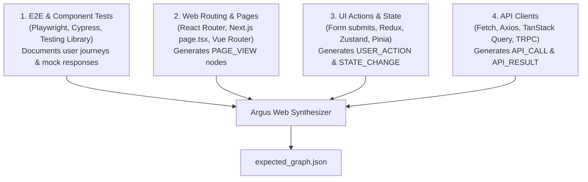

# Argus Web Graph Extractor Skill

This skill extracts an **Argus Expected Behavioral Graph** from web applications by analyzing **E2E tests (Playwright, Cypress, Vitest)** alongside router definitions and API clients.

---

## The 4 Web Architectural Pillars

---

## Web Node Mapping Rules

| Web Code Pattern | Argus Node Type | Example Label |
|---|---|---|
| `page.goto('/checkout')` or `<Route path="/checkout">` | `PAGE_VIEW` | `PageView:/checkout` |
| `page.click('button#pay')` or `<button onClick=...>` | `USER_ACTION` | `Click:PayNowButton` |
| `setIsLoading(true)` or `state.status = 'processing'` | `STATE_CHANGE` | `StateChange:ProcessingPayment` |
| `fetch('/api/v1/charge', { method: 'POST' })` | `API_CALL` | `ApiCall:/api/v1/charge` |
| HTTP 200 response | `API_RESULT` | `ApiResult:200:/api/v1/charge` |
| AbortController timeout / 504 Gateway Timeout | `API_RESULT` | `ApiResult:TIMEOUT:/api/v1/charge` |
| Browser CORS preflight error | `API_RESULT` | `ApiResult:FAILED:/api/v1/charge` |
| `window.onerror` or uncaught boundary | `ERROR` | `Error:ChunkLoadError` |
