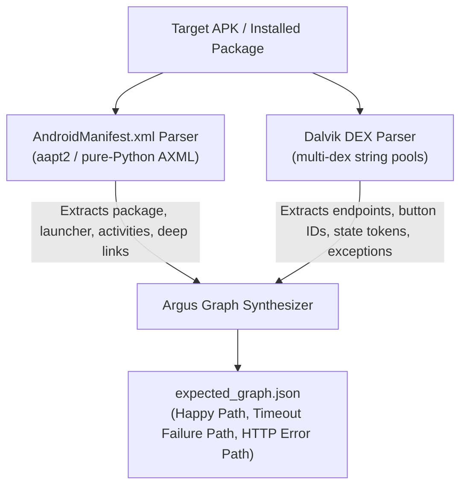

# Argus APK Analyzer — Black-Box Behavioral Reconstruction

Generate an **Argus Expected Behavioral Graph** (`expected_graph.json`) from any Android APK file or installed on-device application without needing access to the original source code repository via **Black-Box Behavioral Reconstruction**.

---

## 🎯 White-Box vs. Black-Box in Argus

| Mode | Paradigm | Tool to Use | Input Required |
|---|---|---|---|
| **White-Box** | Code & Test Mining | [`skills/android-graph-extractor/`](../../skills/android-graph-extractor/) | Kotlin/Java test suites (`*Test.kt`), NavHost, & source code |
| **Black-Box** | Behavioral Reconstruction | [`tools/apk-analyzer/`](./) | Compiled `.apk` file or installed app package via ADB |

---

## 🌟 Key Capabilities

* **Zero Native Dependencies Needed:** Built-in pure-Python AXML (Binary XML) and multi-DEX header & string pool parsers. Runs on any OS (Windows, macOS, Linux).
* **High-Fidelity Auto-Discovery:** Automatically detects `aapt2` and `adb` if the Android SDK is installed on your machine for enhanced manifest extraction.
* **Direct On-Device Extraction:** Target any installed app on a connected phone or emulator using `--device` — Argus automatically resolves the remote path and pulls the base APK over ADB.
* **Synthesizes Complete Behavioral Flows:**
  * Maps launcher and secondary screen navigation.
  * Discovers action buttons, click labels, and user triggers.
  * Discovers network endpoints (`/api/...`, `https://...`) and timeout failure signatures (`SocketTimeoutException`).
  * Establishes divergence nodes (`divergesFromHappyPathAt`) and known root causes.

---

## 🚀 Quickstart & Usage

### 1. Analyze a Local APK File
```bash
python tools/apk-analyzer/analyzer.py path/to/app-debug.apk -o expected_graph.json
```

### 2. Analyze an Installed App from a Connected Phone
Connect your Android device or emulator with USB Debugging enabled:

```bash
# Analyze directly from the device:
python tools/apk-analyzer/analyzer.py com.example.myapp --device -o expected_graph.json
```

### 3. List Installed Applications on Connected Device
```bash
python tools/apk-analyzer/analyzer.py --list-packages
```

---

## 🔍 How the Analyzer Works



1. **Manifest Deconstruction (`manifest_parser.py`):**
   * Extracts package name, version codes, application label, and permissions.
   * Identifies the primary **Launcher Activity** (`android.intent.action.MAIN` + `android.intent.category.LAUNCHER`).
   * Maps navigable secondary activities, exported components, and deep-link schemes (`http`, `https`, custom schemes).
2. **DEX String Pool & Bytecode Analysis (`dex_parser.py`):**
   * Parses all `classes*.dex` files in the APK.
   * Discovers API endpoints (`/api/...`, `/v1/...`, `https://...`).
   * Discovers action triggers and button IDs (`btnComposeEmail`, `btnSend`, `TapSendEmail`).
   * Identifies state tokens (`Uploading`, `EmailSent`, `UploadFailed`).
   * Discovers network failure classes (`SocketTimeoutException`, `UnknownHostException`).
3. **Graph Synthesis (`graph_synthesizer.py`):**
   * Conforms strictly to the Argus Behavioral Graph Schema.
   * Generates `happy_path`, `timeout_failure_path`, and `http_error_path`.
   * Automatically marks divergence points (`divergesFromHappyPathAt: "n_api_call"`) and known causes.

---

## 📋 CLI Options Reference

```
usage: analyzer.py [-h] [-o OUTPUT] [--device] [--list-packages]
                   [--app-version APP_VERSION] [--workflow-name WORKFLOW_NAME]
                   [--verbose] [target]

positional arguments:
  target                Path to an .apk file (e.g. app-debug.apk) or package name if using --device

options:
  -h, --help            show this help message and exit
  -o OUTPUT, --output OUTPUT
                        Output path for the generated expected_graph.json (default: expected_graph.json)
  --device              Pull and analyze an installed app from a connected Android device via ADB
  --list-packages       List third-party installed packages on connected Android device and exit
  --app-version APP_VERSION
                        Override the application version tag (defaults to version in APK manifest)
  --workflow-name WORKFLOW_NAME
                        Custom name for the synthesized workflow (e.g. SendEmailWorkflow)
  --verbose             Print verbose details of discovered DEX tokens and classes
```
