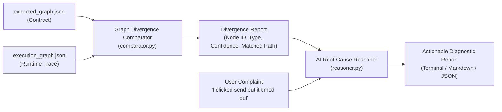

# Argus AI Diagnostic Engine

The core reasoning and divergence analysis engine for **Argus: SystemSleuth**.

It takes:
1. **Expected Behavioral Graph** (`expected_graph.json`): The contract of intended application workflows and known failure modes.
2. **Recorded Execution Graph** (`execution_graph.json`): The chronological runtime trace captured by the on-device SDK.
3. **Optional User Complaint** (Natural Language): What the end-user experienced in plain words (e.g. *"I clicked Pay Now, but it kept loading and never placed my order"*).

And outputs an actionable, structured diagnosis with:
- **Divergence Node & Type:** Pinpoints the exact state or API call where reality split from expectation (e.g., `TIMEOUT`, `CORS_POLICY_VIOLATION`, `HTTP_5XX_SERVER_ERROR`, `HALTED_EXECUTION`).
- **User-Facing Explanation:** Empathetic, non-technical plain English explaining what happened and reassuring whether data was safe.
- **Developer Root-Cause Analysis:** Technical details, latency, status codes, exception traces, and matched known failure modes.
- **Actionable Remediation Checklist:** Step-by-step developer actions to reproduce and fix the bug.

---

## 🏗️ Architecture



---

## 🚀 CLI Usage

### 1. Diagnose a Runtime Failure
```bash
python tools/diagnostic-engine/diagnose.py \
  -e spec/expected_graph.json \
  -a spec/sample_execution_graph.json \
  -q "I clicked Send Email with my PDF report, but it never confirmed and gave an error" \
  -o diagnosis_report.md
```

### 2. Output as JSON for Automated Pipelines / CI
```bash
python tools/diagnostic-engine/diagnose.py \
  -e spec/expected_graph.json \
  -a spec/sample_execution_graph.json \
  -o diagnosis.json
```

---

## 🌐 Running as a Local Diagnostic Server

Argus includes a zero-dependency HTTP server that allows in-app widgets or remote test runners to submit graphs over HTTP and receive instant diagnoses:

```bash
python tools/diagnostic-engine/server.py 7890
```

### Send a Diagnostic Request:
```bash
curl -X POST http://localhost:7890/api/diagnose \
  -H "Content-Type: application/json" \
  -d '{
    "expected": { ... },
    "actual": { ... },
    "query": "I tapped Send Email but the upload failed"
  }'
```

---

## 🧪 Running Unit Tests

Verify the diagnostic engine against reference Android and Web test traces:

```bash
python tools/diagnostic-engine/test_engine.py
```

---

## 📋 CLI Options Reference

```
usage: diagnose.py [-h] -e EXPECTED -a ACTUAL [-q QUERY] [-o OUTPUT]
                   [--api-key API_KEY]

options:
  -h, --help            show this help message and exit
  -e EXPECTED, --expected EXPECTED
                        Path to expected_graph.json (the behavioral contract)
  -a ACTUAL, --actual ACTUAL
                        Path to execution_graph.json (the recorded runtime trace)
  -q QUERY, --query QUERY, --issue QUERY
                        Optional natural language complaint from user
  -o OUTPUT, --output OUTPUT
                        File path to save the diagnostic report (.md or .json)
  --api-key API_KEY     Optional Gemini or Google AI API key for enhanced LLM synthesis
```
